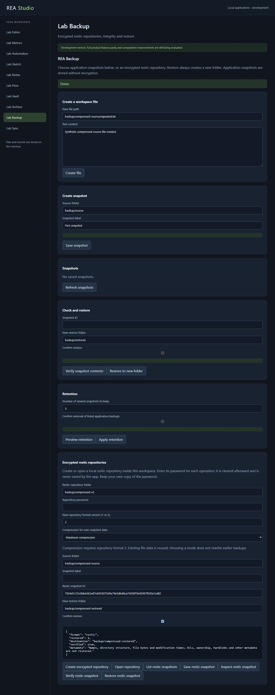
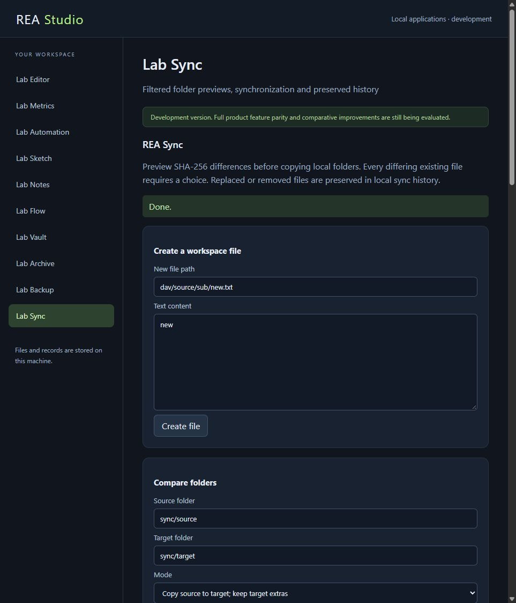

# Compression and remote synchronization checkpoint

The current development applications add genuine compressed LZMA/LZMA2 archives, native compressed restic v2 writing, and generic WebDAV synchronization. **Zero of the ten applications is a complete original-product replacement.** The goal remains active: every documented feature and the requested comparisons of speed, resources, usability, compatibility and reliability remain acceptance requirements.

## Evidence at this checkpoint

The combined [development receipt](results/development-validation.json) records **496 passing implemented-contract tests, 0 failures and 0 skips**, run serially on Node v24.16.0 / win32 x64. It fingerprints the complete collected source before and after execution and requires identical lists and bytes. Exact historical test sources remain integrity checked; they are excluded from current test execution because historical failed experiments are evidence, rather than current acceptance tests.

| Capability | Reproducible evidence | Limits |
| --- | --- | --- |
| LZMA/LZMA2 archive read/write | [169 passing checks](apps/archive/lzma-validation.json), [source-assisted provenance](apps/archive/lzma-provenance.json), [compatibility boundaries](apps/archive/LZMA-COMPATIBILITY.md) | Bounded container/dictionary/output sizes; unsupported encryption, volumes and complex filter/binding combinations; incomplete encoder search strategies. |
| Compressed encrypted restic writing | [13 integration/review checks](apps/backup/results/compression-validation.json), [20 exact preserved study artifacts](apps/backup/results/compression-source-study/preservation-manifest.json), [compression policy](apps/backup/COMPRESSION.md) | Fixed 1 MiB chunking and one blob per pack; Node/libzstd mode selection is not original encoder equivalence; metadata/ACL/ownership and repository maintenance remain incomplete. |
| Generic WebDAV transfer | [72 Sync checks, including 37 new WebDAV checks](apps/sync/results/webdav-validation.json), [preserved original sources](apps/sync/results/webdav-source-verification.json), [compatibility boundaries](apps/sync/WEBDAV-COMPATIBILITY.md) | Generic local-to-remote operations only; vendor extensions, reverse transfers and scheduling remain open; no whole-tree transaction guarantee. |
| Rendered application workflows | [Three source-bound browser records](results/browser-compression-remote-verification.json), 25 source fingerprints and five screenshots | Synthetic local fixtures; finite workflows, separate observer attribution and exact source identities; not exhaustive usability or security assessment. |

## Original-program comparisons and actual interfaces

Archive writes compressed 7Z payloads which the authenticated 7-Zip 26.04 executable tests and extracts. The retained experiments include 46 candidate 7Z archives, 12 LZMA wrappers, 25 positive original-decoder cases, seven HTTP exchanges and 23 container regressions. The rendered interface both creates LZMA and LZMA2 archives and extracts an original-generated archive with exact file hashes and recorded modification times. In the browser's 21,000-byte two-file example, candidate LZMA2 and LZMA archives occupy 349 and 347 bytes; the original default archive occupies **310 bytes**. This is a measured remaining compression gap. Historical failed ratio experiments and the later threshold change remain explicitly preserved; they do not constitute a preregistered performance pass.

Backup's six writer configurations cover v1 plus the five v2 compression modes. Authenticated restic 0.19.1 checks, indexes and restores the candidate repositories. Independent review also exercises large files, bounded Zstandard windows, corrupt payloads, mixed versions, original-program append and blob reuse. One valid original metadata-padding case exceeds the candidate's 16 MiB metadata limit and is rejected: compatibility remains bounded. The actual interface creates a v2 repository, saves 41,000 bytes with maximum compression, verifies them and restores exact bytes. Three additional original-program calls independently check data, inspect compressed indexes and restore the same browser snapshot. Password fields clear after all four interface operations, and the inspected workspace/record files contain no fixture password.

WebDAV compares against authenticated rclone 1.75.2 in **274 original executions**, covering 128 comparison profiles, 1,408 decisions, eight held-out transfer folders and four primitive cases. Sixteen complete official source files support 29 line-bound contracts. Generic WebDAV lacks a shared content hash/modification-time contract in these fixtures; default and checksum fallback decisions use size, while SHA-256/strong ETag checks provide separate candidate-side mutation safeguards. Those concepts are recorded separately rather than presented as original checksum equivalence.

The real WebDAV interface lists a remote folder, previews two copies/one removal/one new folder, downloads a credential-free preview, and refuses removal without explicit approval. The refused operation leaves remote files unchanged. The approved operation replaces/uploads the expected files, removes the approved extra file, leaves the excluded file, and preserves exact prior bytes locally. Password fields clear, and inspected workspace/record files contain no fixture credentials. Shared-host WebDAV busy rejection happens immediately, without retaining credential-bearing requests in the local-operation queue; the held-request host check observes just one remote request.

## Study integrity and remaining work

The preceding 345-test public checkpoint is revision `64238267b332bb3a8ac5435a613a596a06311f59`. Its [snapshot manifest](results/milestones/native-workflows-20261012/snapshot-manifest.json) retains eight receipts and 200 exact source/proof snapshots. Earlier milestones, original observations, failures, raw test output and licenses remain available. Current evidence binds exact implementation bytes; historical evidence binds its preserved historical bytes and is not silently recertified against newer sources.

These are finite component and workflow studies, with explicit hypotheses, artifact identities, failure cases and repeatable measurements. They have not undergone academic peer review. Test counts alone do not prove every documented feature, production security, full-product superiority or comparative resource efficiency.

Next work reviews original Rabin chunk compatibility before integration, corrects measured calculation regressions with paired original benchmarks, expands native workflow routing/fan-in, and continues exhaustive requirement discovery and implementations across all ten products. Universal superiority remains unestablished; every original documented feature and every requested comparison category stays open until verified.
