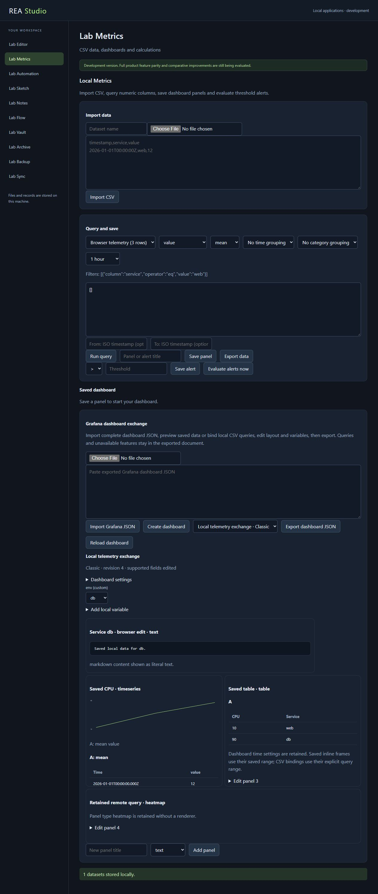

# Dashboard editing, workflow execution and archive formats

Recorded on 12 October 2026. Development continues under the accepted objective: every documented original-product feature, compared across speed, resource use, usability, compatibility and reliability. **Zero complete replacements are certified. The development goal remains active.** This milestone adds functioning contracts, fixes original-compatible cases and corrects a measured editor regression.

## Working changes and independent checks

| Application | Added behavior | Evidence and boundary |
| --- | --- | --- |
| Metrics | Complete imported Grafana dashboard JSON retention; selective Classic/API-envelope/V1 settings, layout, panel and variable edits; saved-frame text/table/stat/time-series previews and separate local CSV query bindings. | 21 local tests include real HTTP restart persistence. Pinned generated Classic types accept a complete generated document and reject malformed field types; three untouched official fixtures export byte-identically. V1's schema has an unstructured spec. No original Grafana server/client, migrations, full plugin rendering or remote queries were executed. V2 is retained without editing/rendering. [Contracts and evidence](apps/metrics/GRAFANA-EXCHANGE.md). |
| Automation | HTTP methods, query/headers, JSON/raw requests, response modes, redirects, whole-response timeouts and bounded retries; node error policies, waits, saved-workflow calls, asynchronous run status/cancellation and redacted persistent histories. | 28 tests exercise synthetic loopback HTTP, error/retry/cancellation, nested calls, byte/item budgets and persisted host behavior. Browser execution returns status200; a running wait cancels with a retained failure location. Requests can cause repeated side effects when retried. Full original n8n was not executed; native workflow formats, expression/item-linking semantics and bundled integrations remain open. [Source comparison](apps/automation/SOURCE-COMPARISON.md). |
| Archive | Classic ZIP/ZIP64, signed/unsigned streaming descriptors, legacy CP437/Unicode Path names, source timestamps and compression controls; TAR/PAX/GNU-longname regular-file/directory exchange; GZIP/TAR.GZ with optional headers, concatenated members and integrity checks. | Original 7-Zip Extra26.04 independently reads generated archives and creates archives replayed through these readers. .NET independently checks ZIP and DOS local-time extraction. Windows bsdtar checks supported TAR/PAX and compressed TAR paths. ZIP and GZIP validate content CRC; TAR validates headers/structure and has no content CRC. All remain bounded in-memory formats; encryption, 7z/LZMA/XZ/BZIP2, other formats, large archives, update operations and original interfaces remain open. [ZIP evidence](apps/archive/compatibility-evidence.json), [format evidence](apps/archive/formats-validation.json). |
| Editor | Compact reachable Myers frontiers/trace storage, direct getter access, run-based backtracking and a single-change fast path, retaining exact minimum-edit behavior and the bounded linear-space fallback. | The latest matching getter benchmark has seven faster medians and one tie across eight cases. The reduced witness retains minimum edit cost9 versus original11. Three independent fresh optimization runs retain a small loss in one case. The separate line-interface comparison still has regressions. [Optimization follow-up](results/editor-performance-followup.json), [current shared comparison](results/sequence-comparison.json). No full editor or universal performance/resource claim. |

The [prior native-exchange milestone](NATIVE-EXCHANGE-MILESTONE.md) and its exact historical receipts are preserved. Notes, Sketch and Vault retain their previously verified native format contracts; Flow, Backup and Sync retain their implemented local development workflows. Every application's full-product completion gates remain open.

## Corrections and limits retained in the evidence

Independent ZIP review reproduced three files/behaviors accepted by original implementations: ZIP64 end-record disk sentinels, streaming entries whose ZIP64 descriptor width is established by the central directory, and DOS timestamps expressed in local wall time. Regression fixtures verify each correction with the pinned original7za and/or independent .NET implementation. ZIP64 layout support does not lift the 16MiB per-file/64MiB total limits.

TAR export now puts fractional, negative and out-of-range legacy-header modification dates into PAX metadata with a bounded placeholder header date. The reader retains their exact supported millisecond values. Original7za accepts and extracts the test archives but wraps the observed year2300 and year1900 timestamps; this is a bounded measured difference, not full metadata superiority.

This host's Windows bsdtar3.8.8 rejects the tested CJK/emoji PAX names and crashes when independently creating one such PAX archive. Its positive comparisons use supported ASCII/Latin-1 names. Pinned original7za validates and extracts the full Unicode test corpus. The native limitation is preserved rather than counted as successful exchange or silently skipped.

## Verification and reproduction

The [combined development receipt](results/development-validation.json) records **176 passing tests, 0 failures and 0 skips**, and binds the complete test collection to exact implementation SHA-256 hashes. Test counts represent implemented contracts and regression fixtures, not distinct original features, a coverage percentage or independent statistical samples. Run `npm run verify` from this directory to reproduce the collection on this machine. Original Windows oracles require the preserved study artifacts; skips on another platform remain coverage gaps.

Run `npm run benchmark` and `npm run benchmark:sequence` for the distinct editor comparisons. Matching getter benchmarks use separate workers, equal input setup outside timing, warmups and timed samples, followed by replay validation. Whole-worker memory includes imports and validation; observed sample quantiles are not confidence intervals. Fresh runs can vary, especially at microsecond durations.

The [current browser record](results/browser-execution-verification.json) verifies four added workflows with synthetic data in a separate local workspace and independently checks downloaded/persisted outputs. The saved dashboard survives host restart; the corrected TAR.GZ export/extraction also runs after restart. The [initial ten-app record](results/browser-verification.json) and [historical native-exchange record](results/browser-compatibility-verification.json) remain distinct. These are functional interface checks, not comparative accessibility/usability studies or every-feature verification.

## Work remaining under the full accepted scope

The [status record](STATUS.json) and [requirements crosswalk](requirements/README.md) retain the unresolved complete-product release/edition/platform bindings and atomic feature inventory. Current broad capability areas do not establish an exhaustive denominator. Native workflows/providers, full format/protocol/plugin ecosystems, whole-product performance/resource comparisons, comparative usability/accessibility, long-running fault recovery and independent review remain required. No completion notification should be sent from this milestone.
