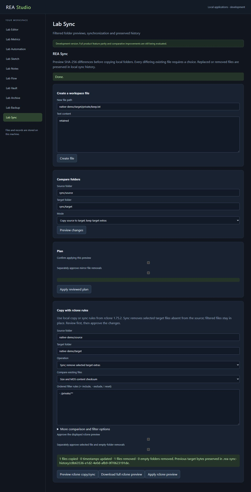

# Native workflows, synchronization and archive milestone

Recorded on 12 October 2026. The accepted scope remains every documented feature of the ten original products, with improvements in speed, resource use, ease of use, compatibility and reliability. This checkpoint adds working capabilities and reproducible bounded comparisons. **Zero complete replacements meet the full acceptance standard. The goal remains active.**

## Working capabilities

| Application | Added behavior | Evidence | Open boundary |
| --- | --- | --- | --- |
| Automation | Retains native n8n documents; edits selected nodes and connections; saves revisions; executes Manual Trigger, Edit Fields, If, HTTP Request and interval Wait; records durable checkpoints, cancellation and history | Pinned n8n / n8n-nodes-base 2.16.0 modules and source methods; exact-output, rejection, normalized transport and safe-property deviation counts are separate in the [native receipt](apps/automation/native-validation.json); real browser run resumes the same saved revision after host restart | Five selected node versions/options; bounded whole-value expressions; HTTP fixture transport is independent of complete n8n core; full scheduling, credentials, connectors, queues, expression engine and editor remain open |
| Sync | Ordered rclone filters; size, checksum and modification-time comparisons; local copy/sync previews; stale-input checks; explicit removal approval; preserved previous target bytes | Original rclone 1.75.2: 56 filter settings, 1,400 comparison decisions and 21 dry-run/actual folder scenarios; focused suite and bounds in the [native receipt](apps/sync/results/native-verification.json) | Local folders only; provider/protocol support, bidirectional scheduling and full product/resource comparisons remain open |
| Archive | Creates, lists, verifies and extracts native Copy/DEFLATE 7Z archives, including solid folders and supported encoded headers | 68 archive tests, including 26 added 7Z checks; original complete 7-Zip 26.04 accepts and extracts outputs; actual browser archive/restore is byte verified in the [receipt](apps/archive/sevenzip-validation.json) | Compressed LZMA/LZMA2 remains separately staged at this checkpoint; filters, encryption, updates, volumes, streaming and complete formats remain open |
| Backup | Calibrates stronger new repository password keys with a fixed floor and bounded host adjustment | Four focused checks; original restic 0.19.1 opens, checks and restores native v1/v2 repositories with the new keys; [policy receipt](apps/backup/results/kdf-policy-validation.json) and actual browser exact-byte restore | Distinct calibration policy; existing keys are not migrated; security review, Rabin chunking, compression writing, pack batching, remote providers and full metadata remain open |
| Metrics | Shares one sorted array across requested percentiles while preserving all 124 released calculation IDs | 2,910,751 original reducer comparisons and 14,240 helper comparisons with zero differences; [performance follow-up](results/metrics-performance-followup/followup.json) retains all exploratory trials | Two workload medians improve; three remain slower; full dashboards/query engines/providers and comparative usability/resources remain open |

The other five applications retain their previously documented capabilities: editor, sketch, notes, Node-RED flows and encrypted vault exchange. This checkpoint does not silently enlarge the scope of their original evidence.

## Verification and corrections

The [combined development receipt](results/development-validation.json) records 345 passing tests, zero failures and zero skips. It checks identical source lists and bytes before and after the run; a source mutation prevents a final receipt. The suite covers implemented contracts, rather than every documented original feature.

The [browser record](results/browser-native-workflows-verification.json) binds five application checks to source identities and screenshots. Local sync copies fresh content, removes only explicitly approved content, retains excluded files and preserves both overwritten and removed bytes. Automation saves a revision, reaches an interval-Wait checkpoint, survives a stopped/restarted host and completes the same run. Recovery begins on the first native API request; this is not an autonomous background startup service. Backup creates, snapshots, checks and restores a calibrated version-2 repository with exact content; its password input clears after all four operations. Metrics renders all 124 results, then verifies six visible null/percentile results. Archive's separate reviewer-owned Chrome check is identified explicitly.

Deterministic validation exposed automation history visibility and cancellation races around queued checkpoint writes. These were corrected and the failed evidence retained, rather than changing test assertions. Other corrections protect bounded caller/returned-record snapshots, safe own-property handling, exact public module routes, stale UI selection and native workflow JSON retention. Two isolated original Set-node prototype behaviors are deliberately not reproduced; they are recorded as deviations, not matching outcomes or proof of a complete-original-runtime vulnerability.

Sync validates and privately snapshots inputs before awaiting a queue, and snapshots returned previews separately. Metadata/entry/depth/work and file-size limits are enforced. Rejected previews have no filesystem effects; partial applies report retained recovery bytes. Resource stress observations concern the bounded candidate and include fixture setup; they are not isolated original-versus-candidate measurements.

The new backup policy uses scrypt N=32,768 and r=8, a minimum p=13 and maximum p=32, with a 500 ms calibration target. Fresh salts and actual-password derivation remain separate from the synthetic calibration probe. Existing keys keep their saved parameters. Matching the tested original formats does not establish stronger security on every host or exact original calibration behavior.

## Measured improvement and remaining regression

Three fresh paired trials for each of five calculation workloads retain exact output equality. Median speed ratios of original over candidate are about 86.24 for all 99 percentiles and 25.24 for all 124 calculations. Small standard calculations, large standard calculations and a single percentile remain approximately 5.4%, 1.9% and 1.3% slower in this exploratory run. Both modules load in each worker, so memory is not isolated; concurrent development adds measurement noise. No significance or whole-product superiority claim follows from these medians. The rejected alternative and its regressions are preserved alongside the accepted source.

## Source provenance and reproduction

This is source-assisted reverse engineering, with pinned original source/package/executable identities and retained license notices. Original executables and test dependencies are independently acquired into ignored local caches. Application runtime does not execute the original programs. Finite comparisons, development tests and internal review do not establish production security, an exhaustive feature denominator or academic peer review.

Application-specific instructions:

- [Automation native contract and original harness](apps/automation/NATIVE-SOURCE-COMPARISON.md).
- [Local rclone compatibility](apps/sync/RCLONE-COMPATIBILITY.md).
- [7Z compatibility and limits](apps/archive/SEVENZIP-COMPATIBILITY.md).
- [Backup password policy](apps/backup/KDF-POLICY.md).
- [Grafana calculation contract](apps/metrics/GRAFANA-CALCULATIONS.md) and [performance reproduction](results/metrics-performance-followup/README.md).

Acquire the original fixtures using each application's documented bootstrap, then run from the repository root:

```text
node products/rea-studio/scripts/verify-development.mjs
node scripts/verify-records.mjs
```

The preceding [native core checkpoint](NATIVE-CORE-MILESTONE.md) at revision `50155ea79ca43fd38842619e9acab7c0ea1976b0` remains historical. Its seven exact receipts and 146 source/proof snapshots are retained in the [snapshot manifest](results/milestones/native-core-20261012/snapshot-manifest.json). Older successful checks remain bound to their original bytes.

Next work is already staged locally for genuine compressed LZMA/LZMA2, WebDAV synchronization and compressed restic writing. Staged results are not integrated capability claims. The 232 broad capability rows remain discovery scaffolding; exhaustive release/edition/platform inventories, remaining functionality and full comparative acceptance are still required by [ACCEPTANCE.md](ACCEPTANCE.md) and [STATUS.json](STATUS.json).


