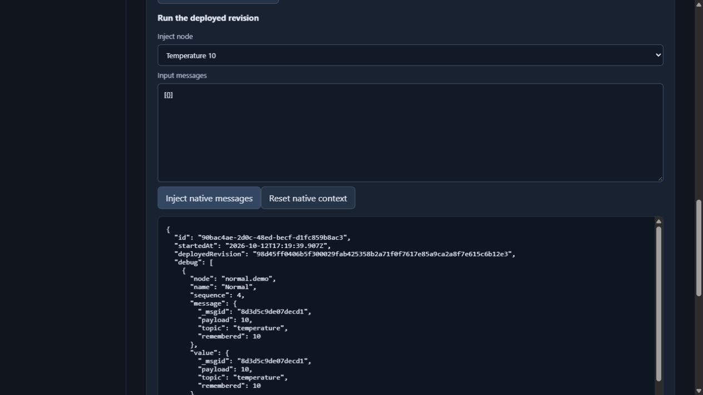

# REA Studio development applications

Ten local applications are being developed toward the user's requested full replacements. This directory contains working initial implementations and testable contracts. **None is a complete replacement for its original product.** Full feature parity, full-product comparison and universal superiority have not been established.

The [acceptance requirements](ACCEPTANCE.md) retain the user's full scope. The [documentation crosswalks](requirements/README.md) begin release-specific requirement discovery. [STATUS.json](STATUS.json) records unresolved completion conditions; individual application READMEs list implemented capabilities and concrete gaps. Historical reverse-engineering studies remain in [`projects/`](../../projects/).

## Run on this machine

Install Node.js 24.7 or later, then run:

```text
cd products/rea-studio
npm start
```

Open `http://127.0.0.1:4310`. There are no third-party runtime packages to install. The shared application host provides isolated file workspaces, persisted JSON records, same-origin session protection and serialized local mutations and immediate WebDAV busy rejection. Data defaults to the lab's ignored `.local/rea-studio/` directory. `REA_STUDIO_DATA` can select another data directory; `node server.mjs --port 4311` selects another port.

The host binds only to this machine. It is a development application for synthetic fixtures and evaluation; production security assessment, unrestricted files, remote accounts and broad vendor compatibility remain separate requirements. The encrypted local vault record uses its own format; supported KeePass KDBX databases can now be imported and exported.

| Application | Implemented starting point | Details |
| --- | --- | --- |
| Lab Editor | File editing, exact line differences and real local Git operations | [Editor](apps/editor/README.md) |
| Lab Metrics | 124 native calculations, CSV data and Grafana dashboard editing | [Metrics](apps/metrics/README.md) |
| Lab Automation | HTTP workflows, waits, saved calls, cancellation and histories | [Automation](apps/automation/README.md) |
| Lab Sketch | Drawing, grouping, freehand and native scene exchange | [Sketch](apps/sketch/README.md) |
| Lab Notes | Notes, attachments, tags and Joplin JEX exchange | [Notes](apps/notes/README.md) |
| Lab Flow | Native Node-RED flow editing, deploy and manual execution | [Flow](apps/flow/README.md) |
| Lab Vault | Encrypted entries, utilities and supported KDBX exchange | [Vault](apps/vault/README.md) |
| Lab Archive | 7Z Copy/DEFLATE/LZMA/LZMA2, ZIP/ZIP64/ZIP93, TAR, GZIP and Zstandard exchange | [Archive](apps/archive/README.md) |
| Lab Backup | Encrypted restic repositories, snapshots, integrity and restore | [Backup](apps/backup/README.md) |
| Lab Sync | Local rules and generic WebDAV synchronization | [Sync](apps/sync/README.md) |

## Verify and compare

```text
npm run oracle:flow
npm run oracle:archive
npm test
npm run verify
npm run benchmark
npm run benchmark:sequence
```

Tests exercise implemented contracts and actual persisted operations. The benchmark needs the original Monaco artifact acquired by `projects/01-vscode-monaco`; follow that study's acquisition instructions. Its [recorded comparison](results/editor-comparison.json) concerns only an internal sequence algorithm and shows both quality differences and costs. It is an exploratory single-machine comparison, with different API payloads, not a product-level superiority certificate.

The additional [getter-sequence comparison](results/sequence-comparison.json) times matching input representations and changed-span payloads over eight recorded cases. Its current eight-case run records seven faster medians and one tie; the separate line-interface run still has regressions. The [three-run optimization follow-up](results/editor-performance-followup.json) retains the pre-optimization evidence and slight regressions. It does not compare whole editors, deadline handling or the original result-class helper API. Git source control requires an installed Git executable.

`npm run verify` reruns the development tests and records exact source hashes in the [validation receipt](results/development-validation.json). The last published full development record contains **937 passing tests and no skips**, with 737 unchanged source fingerprints, for that historical source epoch. The separate hosted Flow/Vault run below passes 282 finite checks; a new full ten-application result remains pending. The historical [packed backups, notebook organization and Vault history milestone](PACKS-NOTEBOOKS-HISTORY-MILESTONE.md) describes the historical455ab6c additions, original comparisons, actual browser checks and unaccepted Metrics experiments. The [Rabin, routing and drawing geometry milestone](RABIN-ROUTING-GEOMETRY-MILESTONE.md) preserves the historical 607-test checkpoint. The [compression and remote synchronization milestone](COMPRESSION-REMOTE-MILESTONE.md) preserves the historical 496-test checkpoint. The [native workflows milestone](NATIVE-WORKFLOWS-MILESTONE.md) preserves the preceding 345-test checkpoint. The [native core milestone](NATIVE-CORE-MILESTONE.md) preserves the preceding 252-test checkpoint. The [execution and archive milestone](EXECUTION-ARCHIVE-MILESTONE.md) preserves the prior176-test checkpoint. The [native exchange milestone](NATIVE-EXCHANGE-MILESTONE.md) preserves the prior revision and its comparative losses. Separate [initial browser checks](results/browser-verification.json), [historical native-exchange browser checks](results/browser-compatibility-verification.json) and [historical execution/dashboard/archive browser checks](results/browser-execution-verification.json) and [historical native-flow/calculation/encrypted-backup browser checks](results/browser-native-core-verification.json) and [historical native-workflow/synchronization checks](results/browser-native-workflows-verification.json) and [historical compression/remote synchronization checks](results/browser-compression-remote-verification.json) and [frozen Rabin/routing/geometry browser checks](results/milestones/rabin-routing-geometry-browser-20261012/snapshot-manifest.json) and [current Automation recovery browser checks](results/browser-automation-recovery-20261012/validation.json) exercise the local interfaces with synthetic data. These receipts demonstrate the implemented capabilities, while the acceptance requirements and feature gaps remain open.



The [native drawing preview](results/compatibility-preview.jpg) is preserved with the historical native-exchange record.

The [initial interface preview](results/studio-preview.jpg) is preserved with its original browser record.

New application code is implemented separately from the prior reference-assisted reconstructions. There are no imports from those reconstructions and no bundled vendor applications. The collection's existing [license scope](../../LICENSES.md) continues to apply to prior study material; no new repository-wide license overrides it.

The [historical455 notebook browser study](results/browser-notebooks-20261012/validation.json) exercises creation, nesting, drafts, rename, note moves, filtering and reload. [Vault history](apps/vault/HISTORY.md) documents native snapshots, confirmed restore and the accepted finite adversarial browser study. Each receipt names its exact source and limits; these are development additions within the full open product scope.

The historical [search/Save/trash/recycle study](SEARCH-TRASH-RECYCLE-SAVE-MILESTONE.md) binds the earlier3ba suite and exact source/negative/independent evidence. Its native confirmation browser attempt remains incomplete; the later in-page confirmation is now installed and tested. Current full-product parity and comparative superiority remain unestablished.

[Prior source-bound Editor browser acceptance](results/editor-current-search-save-browser-20261013/frozen/validation.json.snapshot) passes eight finite groups, including three delayed responses after real disk commits, with31 exact named source identities from before the later Sketch host-route insertion and normal owned cleanup. These checks add browser evidence for search and Save; full feature parity and comparative acceptance remain open.

The historical [notebook confirmation, drawing layout and editor value API checkpoint](NOTES-LAYOUT-VALUE-API-MILESTONE.md) passes **847 implemented-contract checks,0skips and720stable source fingerprints**. Notes passes69focused checks and8browser groups; Sketch39app/2HTTP checks and14browser groups; Editor API13pure checks. Source snapshots, confirmed failures, strictness/precision corrections, independent review and exact historical host transitions remain inspectable. Zero products satisfy the accepted complete replacement and comparative standard.

The last published [Editor pattern search and Vault group recovery checkpoint](EDITOR-PATTERN-VAULT-GROUP-MILESTONE.md) passes **937 implemented-contract checks, no skips and 737 stable source fingerprints**. It adds bounded pattern search, corrected native textarea navigation and recursive Vault group recovery. Exact sources, independent negative reviews, original comparisons and finite browser limits are preserved. Full replacements and comparative acceptance remain under development.

On 15 October 2026, development resumed after an interrupted verification run. That attempt remains incomplete; the later hosted Flow/Vault result below provides separate finite acceptance. The 937-test checkpoint above retains its historical source epoch. [Cloud verification and recoverable evidence](../../CLOUD-VERIFICATION.md) describes the hosted Windows process. The full ten-application suite, full replacements and comparative acceptance remain pending.

The earlier [hosted Flow/Vault recovery run](results/cloud-flow-vault-20261015/preservation-manifest.json) passed **282/282 finite contract checks with zero skips** on revision `14e4859`, with a stable 762-file census and 340 preserved active source snapshots. That record remains a separate source epoch.

The [later Flow/Vault and collector-control run](results/cloud-flow-vault-controls-20261015/preservation-manifest.json) passes **282/282 finite contract checks with zero skips** on revision `a2e0aa7`, with a stable 764-file census and 342 active source snapshots in the verified complete local backup. All four synthetic collector controls pass separately. Its public capsule preserves receipts, raw logs and control evidence; 342 application and 60 synthetic source-snapshot payloads remain in the local backup, with their identities and manifests retained publicly. The [first Archive attempt](results/cloud-archive-aes-composition-failed-20261015/preservation-manifest.json) failed baseline-census qualification before acquisition or tests and remains a separate failed epoch.

The earlier [Archive experimental run](results/cloud-archive-metadata-failure-20261015/preservation-manifest.json) executed **160 checks: 154 passed and six failed**, with zero skips, on the composed overlay based on revision `9970992`. Its 776-file census stayed stable; 354 active source snapshots remain in the complete local backup, while metadata, raw logs and observations are preserved publicly. This remains a separate failed epoch.

The earlier [Archive and prerequisite run](results/cloud-archive-prerequisites-20261015/preservation-manifest.json) executed **161 checks: 155 passed and six failed**, with zero skips, on the overlay based on `b15d166`; its 779-file census stayed stable and 357 source snapshots are backed up locally. Acquisition of the pinned bsdtar EXE/DLL pair and other development inputs succeeded, and one separate original `--version` smoke passed. This failed source epoch remains preserved.

The [later Archive finite experiment](results/cloud-archive-aes-finite-pass-20261015/preservation-manifest.json) passes **161/161 checks with zero failures or skips** after the literal-path correction. Run `38808918976` tested the composed overlay on actual Git merge `7d5bde3`, distinct from PR head `aeb62e6`; its 779-file census remained stable. The path diagnostics confirm real short-name/long-name aliases while the metadata checks pass. All 389 evidence files, including 357 source snapshots, remain in the verified local backup; the public capsule retains all non-source evidence and the omitted snapshots' identities. Original prerequisites, the separate one-process bsdtar smoke and the post-run source check also passed. Production installation remains false; browser acceptance, the full Archive scope and the full ten-application suite remain pending.

The [full hosted replay](results/cloud-full-suite-failed-20261015/preservation-manifest.json) now records 1,042 checks: 1,024 passed, 18 failed and zero skipped, with 770 stable source identities and 348 backed-up active snapshots. It used actual merge `abcac0b2` and the explicit three-source paired-oracle test overlay. The failures concern the Editor Git root observer and Sync WebDAV short Windows root paths. Corrections and a focused hosted replay are pending; the failed record does not replace historical receipts or establish current full-suite acceptance.
