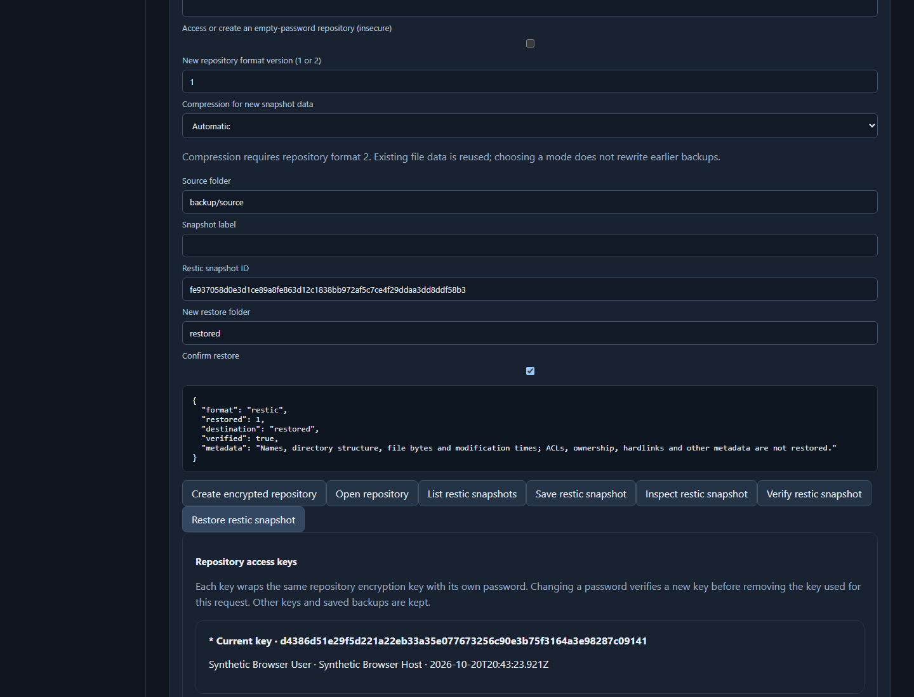

# Native Backup key lifecycle: scoped hosted study

This study implements and tests native repository key listing, addition, removal and password replacement. The tested source is [beab1f3668cf652e7663f3fd7216ac607506ac06](https://github.com/Ginderlax/rea-research-lab/commit/beab1f3668cf652e7663f3fd7216ac607506ac06); the [complete hosted run](https://github.com/Ginderlax/rea-research-lab/actions/runs/39494266022) passed on October 20, 2026. This evidence publication is a separate commit. Its new documents are not substituted for the tested source.

## Question and feature boundary

Can the replacement preserve repository access and snapshot data while managing keys compatible with the pinned Windows restic 0.19.1 executable? The [pinned restic documentation](https://github.com/restic/restic/blob/6aa3a516ce654808a1f28f9fa21e9b7c8e6e90bf/doc/070_encryption.rst) documents list, add, remove and passwd operations. Requirement RESTIC.ENCRYPTION.001 remains incomplete beyond this bounded milestone.

The implementation provides four native actions and visible forms; separate explicit empty-password access/new-key options; readback and same-master/config verification before retiring the old key; unused-key cleanup with sanitized warnings; deletion-completion disclosure; and password clearing after rejected forms. Repository locks, path confinement, bounded key inventories and operation deadlines remain enforced.

## Methods and results

Product execution used GitHub-hosted Windows Server 2022 / X64 and Node 24.16.0. Source admission authenticated the exact sole parent, raw Git objects/modes and 95 frozen dependency files before execution and again afterward. Each role retained97 source files per phase, including the manifest and workflow. Local activity consisted of source authoring, orchestration, ordinary evidence reads and recoverable backup checks.

| Measurement | Observed result |
| --- | --- |
| Finite suite | 160 passed; 0 failed/cancelled/skipped/todo, across 22 modules |
| Existing modules | 116 passes across 17 modules |
| New feature modules | 44 passes including 2 nested tests, across 5 modules |
| Original key comparison groups | 8 passed; setup reached the bodies |
| Real Chromium scenarios | 5 passed;0 retry/flaky/skipped |
| Browser records | 5 case records, 5 screenshots, 34 API calls, 58 owned requests drained |
| Portable local backup | 2 original ZIPs; 423 ordinary uploaded files/5,205,769bytes;both raw logs/595,277bytes |

The [finite roster](finite-pass-roster.json) contains every literal passing test name and module summary. [Browser scenarios](browser-scenarios.json) bind the five cases to their screenshots and successful cleanup. [Identities and results](identities-and-results.json) freeze source/runtime/job/artifact digests and boundaries. Independent ordinary-data reviews passed 1,330 finite and 1,372 browser binding/integrity checks; these are evidence checks, not additional product tests.

The original comparison groups cover both directions of key operations and repository formats 1/2, reopening readers, snapshot data checks/restores, rejected-operation byte preservation, empty-password opt-ins and selected Go metadata cases. The executable ZIP and EXE were hashed before the copied binary/version gate and candidate imports. These outcomes are supported by assertions in the exact authenticated passing source. **Per-command original stdout/stderr/state transcripts were not retained**, so the archive does not independently reconstruct those hidden command values. The source revision is a frozen reference, not proven executable build provenance.

## Failed attempts and corrections

| Source | Hosted run | Recorded result |
| --- | --- | --- |
| [5689660a](https://github.com/Ginderlax/rea-research-lab/commit/5689660a35caa12a5043822e3db1712174b2ccdd) | [39487103023](https://github.com/Ginderlax/rea-research-lab/actions/runs/39487103023) | Admission helper recursion; product tests skipped. |
| [0b133a96](https://github.com/Ginderlax/rea-research-lab/commit/0b133a96f3e9b7533327320bb526e53b8b00d282) | [39488213573](https://github.com/Ginderlax/rea-research-lab/actions/runs/39488213573) | Admission refused. Its no-output cause is inferred from the later diagnostic sibling, not directly measured here. |
| [dfa6b99b](https://github.com/Ginderlax/rea-research-lab/commit/dfa6b99bc56f39f1cf2ac51519b3c5edcc6cd210) | [39489184425](https://github.com/Ginderlax/rea-research-lab/actions/runs/39489184425) | Both roles/phases recorded zero status rows, yet the scalar predicate refused the checkout. Product tests skipped. |
| [af8ce93f](https://github.com/Ginderlax/rea-research-lab/commit/af8ce93fa0038760b52842e62d93419545ab9214) | [39490506074](https://github.com/Ginderlax/rea-research-lab/actions/runs/39490506074) | 139/160 finite passes; 3/5 browser passes. Runtime variable shadowing plus a separate original-fixture path defect. |
| [7a3cd7c8](https://github.com/Ginderlax/rea-research-lab/commit/7a3cd7c8924f00eea81f4fea6a43400774f42492) | [39492898007](https://github.com/Ginderlax/rea-research-lab/actions/runs/39492898007) | 152/160 finite passes and 5/5 browser passes. Eight original groups blocked in setup. |
| [beab1f36](https://github.com/Ginderlax/rea-research-lab/commit/beab1f3668cf652e7663f3fd7216ac607506ac06) | [39494266022](https://github.com/Ginderlax/rea-research-lab/actions/runs/39494266022) | 160/160 finite passes and 5/5 browser passes, including eight original key comparison groups. |

Every attempt remains separately identified. The runtime repair renamed one shadowing configuration variable. The fixture repair placed the authenticated executable under an exclusively owned subdirectory while retaining the strict path validator. Source checks and tests were retained. No failed receipt was rebound to a later commit. Reviewer-only metadata comparator errors were corrected against unchanged evidence without rerunning product tests.

## Deliberate differences and limits

Damaged unused-key handling is repair friendly: the app can skip selected bad key content while authenticating another key, show sanitized warnings and remove an unused malformed key. Upstream key search can stop on other OpenKey errors. Damaged-key comparisons use an explicit known healthy original key hint. A sole-key numeric-username fixture records the original Go type error versus app authentication plus a display warning; fixture-only metadata repair is not an application repair claim.

The native implementation retains its documented 16-key and other resource limits. This Windows study does not establish all restic backend/format/metadata features, complete error compatibility, security readiness or other-platform support. Five successful browser tasks do not establish comparative usability or accessibility. No comparative latency, CPU, memory or energy result was measured here. Whole-product parity, universal superiority and completion of all ten replacements remain unproven.

## Reproduction and feedback

Use the exact tested commit and its reviewed `backup-native-keys-cloud.yml` workflow/source manifest, not this publication commit. The workflow pins its actions/runtime, acquires and hashes the original release, runs all 22 finite modules and 5 browser cases, and checks source again after success or failure. Its repository identity and sole-parent guards are part of the recorded experiment; forks need a separately reviewed identity/manifest and produce a new study.

GitHub artifacts have finite retention. Complete original ZIPs, every uploaded member and raw logs were read back locally with CRC/hash checks and exclusive creation. This public selection includes normalized results and synthetic-fixture screenshots; it does not claim to publish every private raw backup file. Feedback is welcome through repository issues with an exact source, fixture, expected/observed behavior and reproduction steps.

